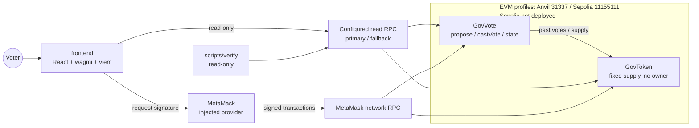
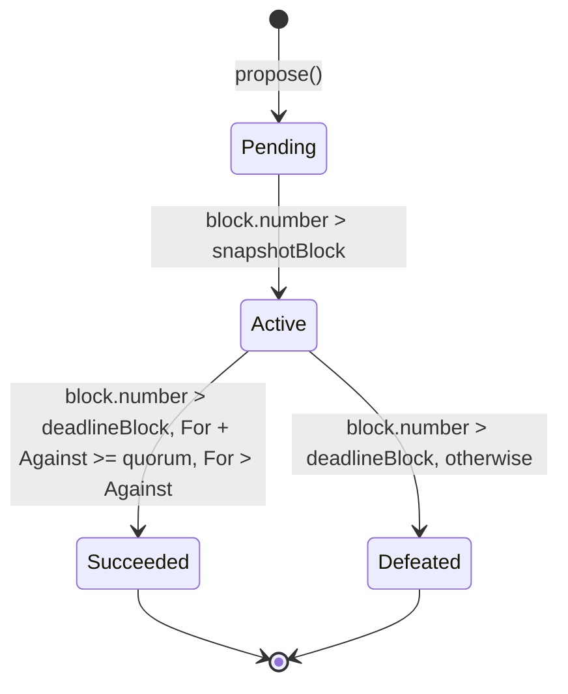

# GovVote

[Tiếng Việt](README.vi.md)

GovVote is an on-chain DAO voting dApp for EVM chains. Voting is token-weighted, and voting power is read from a block-number snapshot (OpenZeppelin `ERC20Votes`). There is no owner, no proposal execution, and every configuration parameter is `immutable` after deploy.

## Status

- Chain profiles support **Anvil (31337)** and **Sepolia (11155111)**. Live-chain testing uses isolated local Anvil; Sepolia support is checked with fixtures only.
- **Not deployed to Sepolia** or any other testnet/mainnet.
- **No independent security audit.** It is a learning project; the GOV token has no monetary value.

## Supported chains

The CLI and frontend share [shared/chains.ts](shared/chains.ts). Mainnet (1) and all other IDs are explicitly rejected before further RPC reads.

| Chain | Default confirmations | Explorer | Deployment evidence label |
|---|---|---|---|
| Anvil, 31337 (default) | 12 | none | `LOCAL_DEPLOYMENT_EVIDENCE` |
| Sepolia, 11155111 | 64 | [Sepolia Etherscan](https://sepolia.etherscan.io) | `PUBLIC_TESTNET_DEPLOYMENT_EVIDENCE` |

64 is a conservative public-testnet confirmation policy, not a finality guarantee. Sepolia verification may lag roughly 13 minutes (64 × 12 seconds = 768 seconds, an estimate). Both labels describe bytecode, token linkage and event/storage consistency observed through an RPC; neither certifies authenticity, audited code or Etherscan source verification. See [threat model](docs/threat-model.md).

Set `VITE_CHAIN_ID` for the frontend and `GOV_CHAIN_ID` for either CLI mode; both default to 31337. Sepolia requires an explicit `VITE_RPC_URL` / `GOV_RPC_URL` and the correct contract addresses. No public RPC endpoint is supplied automatically. Strict CLI `GOV_CONFIRMATIONS` overrides the profile default; legacy tally uses the profile default. Explorer links appear only on profiles with an explorer. Deployment scripts remain local-only in this phase; this is configuration preparation, **not a Sepolia deployment or an audit**.

## Screenshots

Proposal list on a phone (375×812), a tablet (768×1024) and a desktop (1280×800):

<p>
  
  
  
</p>

## Architecture



The frontend reads contract state and sends the user's transactions through an injected wallet. The verify CLI only reads: it rebuilds each tally from `VoteCast` events and compares it with contract storage at the same block.

Proposal state is computed from `block.number` on every call. It is never stored:



## How it works

1. **Delegate.** Holding GOV is not enough: a holder must `delegate` (to self or someone else) to get voting power.
2. **Propose.** Anyone whose voting power at `block.number - 1` is at least `proposalThreshold` can create a proposal (title 1–100 bytes, description up to 1,000 bytes).
3. **Snapshot.** `snapshotBlock = creation block + votingDelayBlocks`. Voting weight is `getPastVotes(voter, snapshotBlock)`. Tokens or delegations that arrive after the snapshot do not count.
4. **Vote.** Accepted while `snapshotBlock < block.number <= deadlineBlock`, where `deadlineBlock = snapshotBlock + votingPeriodBlocks`. One vote per address (For or Against; there is no Abstain).
5. **Result.** Quorum is `ceil(totalSupplyAtSnapshot × quorumBps / 10000)`, rounded up, and is measured on For + Against. A proposal succeeds only if quorum is met **and** For > Against. A tie is Defeated.

## Tech stack

| Area | Tools (versions pinned in the repo) |
|---|---|
| Contracts | Solidity 0.8.28 (EVM `cancun`, optimizer 200 runs), Foundry, OpenZeppelin Contracts v5.6.1, forge-std v1.17.0 |
| Frontend | React 19.3.1, wagmi 3.7.9, viem 2.57.13, TanStack Query 5.105.0, Vite 8.3.5, Tailwind CSS 4.3.3, TypeScript 7.0.2 |
| Verify CLI | Node.js ≥ 24, viem 2.57.11, tsx 4.23.15, TypeScript 7.0.2 |
| Tests | forge test, Vitest 5.0.5, Node test runner (CLI), Playwright 1.64.1 |

npm versions are pinned exactly in `package.json` (no `^` or `~`).

## Quick start (local Anvil)

Requirements: Foundry, Node.js 24+, git with submodules (`git submodule update --init --recursive`).

**1. Build and test the contracts**

```bash
forge build
forge test -vv
forge snapshot --check --fuzz-seed 0x1 --threads 1   # gas report; match CI seed, threads and tool versions
```

Parallel fuzzing makes gas measurements depend on both the seed and the thread count. Compare `.gas-snapshot` only with the same seed, thread count, Foundry 1.7.1 and solc 0.8.28. Regenerate it with `forge snapshot --fuzz-seed 0x1 --threads 1`. These pins apply only to snapshots; `forge test` continues to fuzz with random inputs.

**2. Start Anvil** (in its own terminal; its startup output prints test keys, so it is discarded)

```bash
anvil --port 8545 > /dev/null 2>&1
```

**3. Deploy and seed.** Transactions are signed with `--unlocked --sender`: Anvil's account 0 is already unlocked, so no private key appears in any command or file.

```bash
EXPECTED_CHAIN_ID=31337 TOKEN_RECIPIENT=0xf39Fd6e51aad88F6F4ce6aB8827279cffFb92266 \
PROPOSAL_THRESHOLD_GOV=1000 QUORUM_BPS=1000 VOTING_DELAY_BLOCKS=15 VOTING_PERIOD_BLOCKS=7200 \
  forge script script/Deploy.s.sol:Deploy --rpc-url http://127.0.0.1:8545 \
  --broadcast --unlocked --sender 0xf39Fd6e51aad88F6F4ce6aB8827279cffFb92266

EXPECTED_CHAIN_ID=31337 GOV_TOKEN=<GovToken address from the deploy log> \
DEMO_ALICE=0x70997970C51812dc3A010C7d01b50e0d17dc79C8 \
DEMO_BOB=0x3C44CdDdB6a900fa2b585dd299e03d12FA4293BC \
DEMO_CHARLIE=0x90F79bf6EB2c4f870365E785982E1f101E93b906 \
DEMO_DAVID=0x15d34AAf54267DB7D7c367839AAf71A00a2C6A65 \
  forge script script/SeedDemo.s.sol:SeedDemo --rpc-url http://127.0.0.1:8545 \
  --broadcast --unlocked --sender 0xf39Fd6e51aad88F6F4ce6aB8827279cffFb92266
```

The full demo lifecycle (delegate, propose, mine blocks, vote) is in [docs/phase1-demo-report.md](docs/phase1-demo-report.md), sections 5 and 6b. A future testnet deploy will sign with a Foundry keystore (`cast wallet import ... --interactive`); a raw private key is never passed on the command line.

**4. Run the frontend**

```bash
cd frontend
npm ci --ignore-scripts
cp .env.example .env.local   # then fill VITE_GOV_VOTE and VITE_GOV_TOKEN from the deploy log
npm run sync-abi             # regenerates src/abi/*.ts from forge build output
npm run dev
```

**5. Verify the tallies independently** (read-only, no wallet needed)

```bash
cd scripts/verify
npm ci --ignore-scripts
GOV_VOTE=<GovVote address> npm run verify
```

Exit code 0 means VERIFIED, 1 means MISMATCH, 2 means a configuration or RPC error; strict mode also returns 3 for INCOMPLETE. `GOV_RPC_URL` overrides the default `http://127.0.0.1:8545`. Without `GOV_PROPOSAL_ID` the CLI runs the legacy tally mode; setting `GOV_PROPOSAL_ID` (with `GOV_TOKEN`) runs the strict per-proposal check.

## Testnet deployment procedure (not executed)

Sepolia is **not deployed**. Follow [the Vietnamese Sepolia runbook](docs/sepolia-runbook.md) only with Owner approval: prepare the `govvote-deployer` keystore, check chain ID 11155111, deployer and balance, dry-run **without** `--broadcast`, then obtain Owner confirmation before broadcasting with `--account govvote-deployer`. No raw private key is passed on the command line.

Sepolia requires `TOKEN_RECIPIENT` to equal the actual broadcaster, which receives all 1,000,000 GOV; Owner later confirms each of four transfers separately. SeedDemo is local-only. Read balances/configuration back after each step. Strict verification may lag approximately 13 minutes for 64 confirmations (12-second block estimate, not a finality guarantee).

## Testing

| Layer | What it covers | Result |
|---|---|---|
| Foundry unit | GovToken and GovVote rules, revert paths, boundary blocks | part of 53 |
| Foundry fuzz | 1,000 runs per test (weight equals past votes, threshold boundary, ...) | part of 53 |
| Foundry invariant | 256 runs, depth 50: tallies, one vote per voter, tally frozen after deadline | part of 53 |
| **`forge test` total** | 5 suites: 53 existing tests + 1 script test (11 guard/distribution scenarios) | **54 passed** |
| Mutation (CLI) | Removing the log de-duplication step in `aggregateVotes` is caught by the CLI tests | detected |
| Vitest (frontend) | error mapping, byte counter, tx state machine, verification core, RPC/session logic | **173 passed** (12 files) |
| Node test runner (CLI) | `scripts/verify` cases: duplicates, missing logs, block windows | **37 passed** |
| Playwright (browser) | validation 34, reliability 12, final UI 3, original E2E 12 + hardening 3 | **64 passed** |

Known coverage limit: the invariant suite does not reach every outcome often. Over 40 seeds, only 25% of runs reached at least one Succeeded proposal and 32.5% at least one Defeated proposal with votes. Those outcome branches are covered by deterministic unit tests instead. Details: [docs/phase2a-invariant-report.md](docs/phase2a-invariant-report.md).

## Security and known limitations

From [docs/threat-model.md](docs/threat-model.md) and the project progress notes:

- **The snapshot does not stop buying or borrowing GOV before the snapshot.** Tokens held and delegated by the end of `snapshotBlock` count in full.
- **Sybil and concentration.** This is token-weighted voting, not one-person-one-vote. `hasVoted` blocks per address, not per person.
- **The verify CLI trusts its RPC.** It detects inconsistencies between logs and storage, but an RPC that is wrong in a consistent way can still mislead it.
- **Not tested with a real wallet.** Browser tests use an injected fake wallet; real MetaMask flows are unverified.
- **npm audit:** 0 frontend advisories after upgrading to wagmi 3.7.9 / connectors 8.2.2 (previously 27: 16 high, 11 moderate). Only `injected()` is instantiated; no WalletConnect added. A clean dependency audit does not replace contract security review or real MetaMask QA.
- No owner, no roles, no setters, no mint after deploy. Changing a rule means deploying a new contract.

## Repository layout

| Path | Contents |
|---|---|
| `src/` | `GovToken.sol`, `GovVote.sol` |
| `test/` | unit, fuzz and invariant tests, `mocks/` |
| `script/` | `Deploy.s.sol`, `SeedDemo.s.sol` |
| `frontend/` | React app; unit tests in `tests/`, E2E in `e2e/`, extra browser checks in `validation/` |
| `shared/verification/` | verification logic shared by the frontend and the CLI |
| `scripts/verify/` | read-only CLI that checks `VoteCast` events against storage |
| `docs/` | spec, reports, threat model, ADRs, screenshots |
| `lib/` | forge-std and openzeppelin-contracts (git submodules) |

Documents (mostly in Vietnamese):

- Specification: [docs/GovVote_Thiet_ke_v1.1.pdf](docs/GovVote_Thiet_ke_v1.1.pdf)
- Threat model: [docs/threat-model.md](docs/threat-model.md)
- Architecture decisions: [docs/adr.md](docs/adr.md)
- Phase reports: [Phase 1 demo](docs/phase1-demo-report.md), [Phase 2A invariants](docs/phase2a-invariant-report.md), [Phase 2B verify](docs/phase2b-verify-report.md), [Phase 3 frontend](docs/phase3-frontend-report.md)
- Progress log: [docs/PROGRESS.md](docs/PROGRESS.md)

## Roadmap (not done yet)

- Sepolia deploy with source verification on Etherscan
- Continuous integration (CI)
- Public hosting of the frontend

## Author and license

Author: Lê Tiến Mạnh. Released under the [MIT License](LICENSE).
