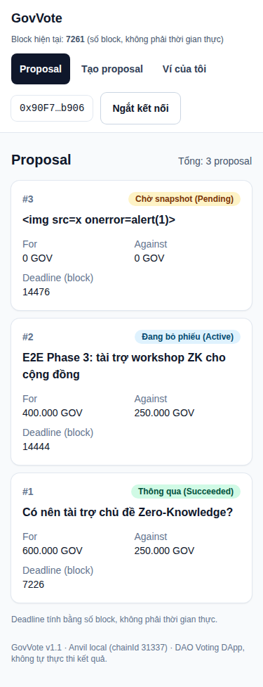
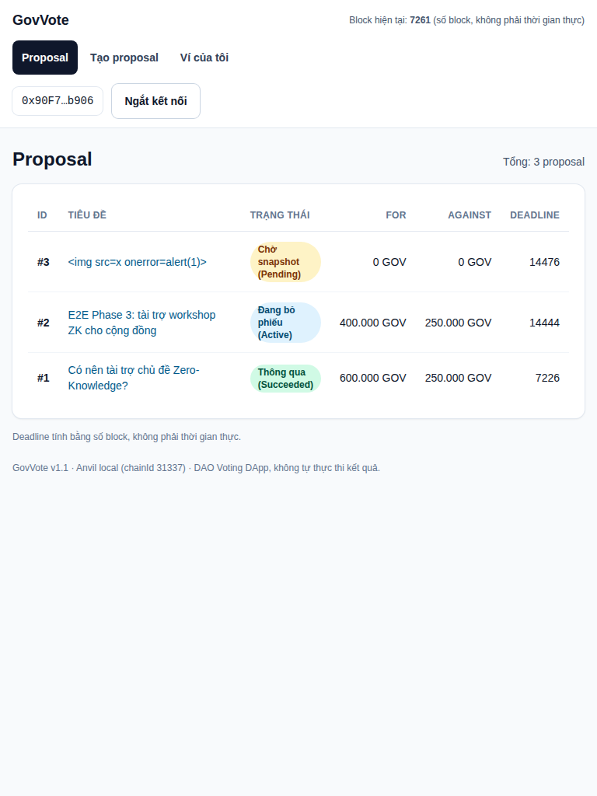
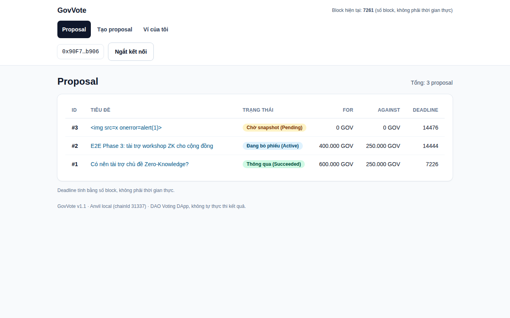
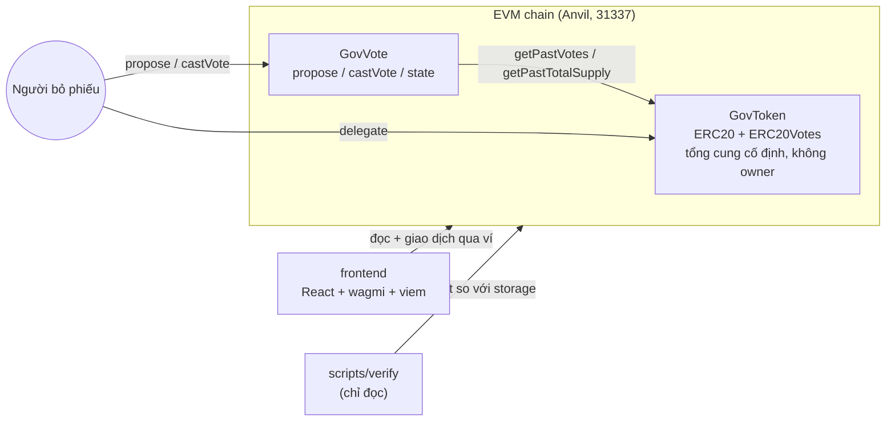
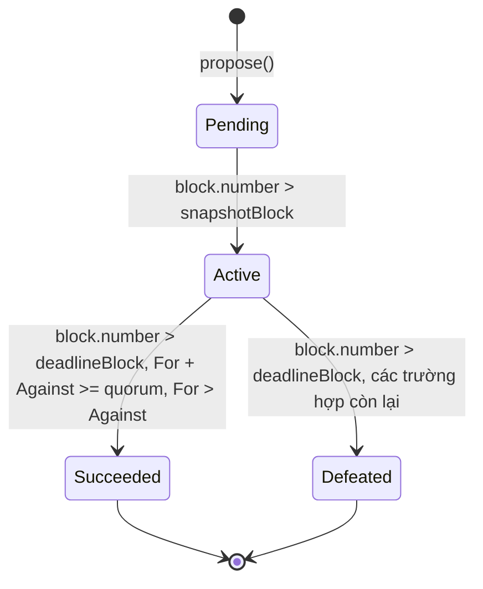

# GovVote

[English](README.md)

GovVote là một dApp (ứng dụng phi tập trung) bỏ phiếu DAO on-chain (trên chuỗi) cho các chain EVM. Bỏ phiếu theo kiểu token-weighted (trọng số theo lượng token), và voting power (quyền biểu quyết) được đọc từ snapshot (ảnh chụp trạng thái) theo số block (OpenZeppelin `ERC20Votes`). Không có owner (chủ sở hữu có đặc quyền), không có execute (thực thi proposal), và mọi tham số cấu hình đều `immutable` (không đổi được) sau khi deploy.

## Trạng thái

- Chỉ chạy và kiểm thử trên **chain Anvil cục bộ** (chain ID 31337).
- **Chưa deploy** lên testnet hay mainnet nào.
- **Chưa có audit (kiểm toán bảo mật) độc lập.** Đây là dự án học tập; token GOV không có giá trị tiền thật.

## Ảnh màn hình

Danh sách proposal (đề xuất) trên điện thoại (375×812), máy tính bảng (768×1024) và máy tính (1280×800):

<p>
  
  
  
</p>

## Kiến trúc



Frontend đọc trạng thái contract và gửi giao dịch của người dùng qua injected wallet (ví nhúng sẵn trong trình duyệt, như MetaMask). CLI verify chỉ đọc: nó tính lại từng tally (tổng phiếu) từ event `VoteCast` rồi so với storage (dữ liệu lưu trong contract) tại cùng một block.

Trạng thái proposal được tính từ `block.number` mỗi lần gọi, không lưu trong storage:



## Cách hoạt động

1. **Delegate (ủy quyền biểu quyết).** Chỉ giữ GOV thì chưa đủ: người giữ phải `delegate` (cho chính mình hoặc người khác) mới có voting power.
2. **Propose (tạo đề xuất).** Ai có voting power tại `block.number - 1` từ `proposalThreshold` trở lên thì được tạo proposal (title 1–100 byte, description tối đa 1.000 byte).
3. **Snapshot.** `snapshotBlock = block tạo proposal + votingDelayBlocks`. Trọng số phiếu là `getPastVotes(voter, snapshotBlock)`. Token hoặc delegation đến sau snapshot không được tính.
4. **Vote (bỏ phiếu).** Nhận phiếu khi `snapshotBlock < block.number <= deadlineBlock`, với `deadlineBlock = snapshotBlock + votingPeriodBlocks`. Mỗi địa chỉ một phiếu (For hoặc Against; không có Abstain).
5. **Kết quả.** Quorum (ngưỡng tham gia tối thiểu) là `ceil(totalSupplyAtSnapshot × quorumBps / 10000)`, làm tròn lên, và đo trên For + Against. Proposal chỉ Succeeded khi đạt quorum **và** For > Against. Hòa thì Defeated.

## Tech stack (công nghệ sử dụng)

| Mảng | Công cụ (phiên bản ghim trong repo) |
|---|---|
| Contract | Solidity 0.8.28 (EVM `cancun`, optimizer 200 runs), Foundry, OpenZeppelin Contracts v5.6.1, forge-std v1.17.0 |
| Frontend | React 19.3.1, wagmi 2.19.5, viem 2.57.13, TanStack Query 5.105.0, Vite 8.3.5, Tailwind CSS 4.3.3, TypeScript 7.0.2 |
| CLI verify | Node.js ≥ 24, viem 2.57.11, tsx 4.23.15, TypeScript 7.0.2 |
| Test | forge test, Vitest 5.0.5, Node test runner (CLI), Playwright 1.64.1 |

Phiên bản npm được ghim chính xác trong `package.json` (không dùng `^` hay `~`).

## Quick start (chạy nhanh trên Anvil cục bộ)

Cần có: Foundry, Node.js 24+, git kèm submodule (`git submodule update --init --recursive`).

**1. Build và test contract**

```bash
forge build
forge test -vv
```

**2. Chạy Anvil** (ở terminal riêng; output khởi động có in key test nên được bỏ đi)

```bash
anvil --port 8545 > /dev/null 2>&1
```

**3. Deploy và seed (nạp dữ liệu demo).** Giao dịch được ký bằng `--unlocked --sender`: account 0 của Anvil đã được mở khóa sẵn, nên không có private key trong lệnh hay file nào.

```bash
TOKEN_RECIPIENT=0xf39Fd6e51aad88F6F4ce6aB8827279cffFb92266 \
PROPOSAL_THRESHOLD_GOV=1000 QUORUM_BPS=1000 VOTING_DELAY_BLOCKS=15 VOTING_PERIOD_BLOCKS=7200 \
  forge script script/Deploy.s.sol:Deploy --rpc-url http://127.0.0.1:8545 \
  --broadcast --unlocked --sender 0xf39Fd6e51aad88F6F4ce6aB8827279cffFb92266

GOV_TOKEN=<địa chỉ GovToken trong log deploy> \
DEMO_ALICE=0x70997970C51812dc3A010C7d01b50e0d17dc79C8 \
DEMO_BOB=0x3C44CdDdB6a900fa2b585dd299e03d12FA4293BC \
DEMO_CHARLIE=0x90F79bf6EB2c4f870365E785982E1f101E93b906 \
DEMO_DAVID=0x15d34AAf54267DB7D7c367839AAf71A00a2C6A65 \
  forge script script/SeedDemo.s.sol:SeedDemo --rpc-url http://127.0.0.1:8545 \
  --broadcast --unlocked --sender 0xf39Fd6e51aad88F6F4ce6aB8827279cffFb92266
```

Toàn bộ vòng đời demo (delegate, propose, đào block, vote) nằm ở [docs/phase1-demo-report.md](docs/phase1-demo-report.md), mục 5 và 6b. Khi deploy testnet sau này sẽ ký bằng keystore của Foundry (`cast wallet import ... --interactive`); không bao giờ đưa private key trực tiếp vào dòng lệnh.

**4. Chạy frontend**

```bash
cd frontend
npm ci --ignore-scripts
cp .env.example .env.local   # rồi điền VITE_GOV_VOTE và VITE_GOV_TOKEN từ log deploy
npm run sync-abi             # sinh lại src/abi/*.ts từ output của forge build
npm run dev
```

**5. Tự kiểm tally** (chỉ đọc, không cần ví)

```bash
cd scripts/verify
npm ci --ignore-scripts
GOV_VOTE=<địa chỉ GovVote> npm run verify
```

Exit code 0 là VERIFIED (khớp), 1 là MISMATCH (lệch), 2 là lỗi cấu hình hoặc RPC. `GOV_RPC_URL` thay cho mặc định `http://127.0.0.1:8545`. Không đặt `GOV_PROPOSAL_ID` thì CLI chạy chế độ legacy tally (đếm phiếu kiểu cũ); đặt `GOV_PROPOSAL_ID` (kèm `GOV_TOKEN`) thì chạy kiểm tra strict (chặt) cho từng proposal.

## Testing (kiểm thử)

| Lớp | Phạm vi | Kết quả |
|---|---|---|
| Foundry unit | quy tắc GovToken và GovVote, các nhánh revert, block biên | nằm trong 53 |
| Foundry fuzz (đầu vào ngẫu nhiên) | 1.000 runs mỗi test (weight bằng past votes, biên threshold, ...) | nằm trong 53 |
| Foundry invariant (bất biến) | 256 runs, depth 50: tally, mỗi voter một phiếu, tally đóng băng sau deadline | nằm trong 53 |
| **Tổng `forge test`** | 4 suite: 4 + 39 unit, 3 fuzz, 7 invariant | **53 passed** |
| Mutation (CLI, cố ý làm hỏng code) | Bỏ bước khử log trùng trong `aggregateVotes` thì test CLI phát hiện | phát hiện được |
| Vitest (frontend) | map lỗi, bộ đếm byte, máy trạng thái giao dịch, verification core, logic RPC/session | **137 passed** (9 file) |
| Node test runner (CLI) | các ca của `scripts/verify`: log trùng, thiếu log, cửa sổ block | **17 passed** |
| Playwright (trình duyệt) | validation 34, reliability 12, final UI 3, E2E gốc 12 | **61 passed** |

Giới hạn độ phủ đã biết: bộ invariant không thường xuyên chạm tới mọi kết quả. Trên 40 seed, chỉ 25% run có ít nhất một proposal Succeeded và 32,5% có ít nhất một proposal Defeated có phiếu. Các nhánh kết quả này được kiểm bằng unit test xác định (deterministic) thay thế. Chi tiết: [docs/phase2a-invariant-report.md](docs/phase2a-invariant-report.md).

## Bảo mật và giới hạn đã biết

Lấy từ [docs/threat-model.md](docs/threat-model.md) và ghi chép tiến độ dự án:

- **Snapshot không chặn việc mua hoặc vay GOV trước snapshot.** Token được giữ và delegate trước khi `snapshotBlock` kết thúc vẫn được tính đủ.
- **Sybil (một người dùng nhiều danh tính) và tập trung token.** Đây là token-weighted voting, không phải mỗi người một phiếu. `hasVoted` chặn theo địa chỉ, không theo người thật.
- **CLI verify tin RPC.** Nó phát hiện chỗ không nhất quán giữa log và storage, nhưng một RPC sai một cách nhất quán vẫn có thể đánh lừa nó.
- **Chưa test với ví thật.** Test trình duyệt dùng ví giả được nhúng vào trang; luồng MetaMask thật chưa xác minh.
- **npm audit:** frontend báo 27 advisory (cảnh báo lỗ hổng) (16 high, 11 moderate, 0 critical), đến từ cây phụ thuộc connector của wagmi (`@wagmi/connectors`). Ứng dụng chỉ khởi tạo connector `injected()`. Muốn hết cảnh báo phải nâng lên wagmi v3, việc này chưa được quyết định. CLI verify báo 0.
- Không owner, không role, không setter, không mint sau deploy. Muốn đổi quy tắc thì phải deploy contract mới.

## Cấu trúc repo

| Đường dẫn | Nội dung |
|---|---|
| `src/` | `GovToken.sol`, `GovVote.sol` |
| `test/` | unit, fuzz, invariant test, `mocks/` |
| `script/` | `Deploy.s.sol`, `SeedDemo.s.sol` |
| `frontend/` | ứng dụng React; unit test ở `tests/`, E2E ở `e2e/`, kiểm tra trình duyệt bổ sung ở `validation/` |
| `shared/verification/` | logic verification dùng chung cho frontend và CLI |
| `scripts/verify/` | CLI chỉ đọc, đối chiếu event `VoteCast` với storage |
| `docs/` | đặc tả, báo cáo, threat model, ADR, ảnh màn hình |
| `lib/` | forge-std và openzeppelin-contracts (git submodule) |

Tài liệu (phần lớn bằng tiếng Việt):

- Đặc tả: [docs/GovVote_Thiet_ke_v1.1.pdf](docs/GovVote_Thiet_ke_v1.1.pdf)
- Threat model (mô hình mối đe dọa): [docs/threat-model.md](docs/threat-model.md)
- ADR (ghi chép quyết định kiến trúc): [docs/adr.md](docs/adr.md)
- Báo cáo các phase: [Phase 1 demo](docs/phase1-demo-report.md), [Phase 2A invariant](docs/phase2a-invariant-report.md), [Phase 2B verify](docs/phase2b-verify-report.md), [Phase 3 frontend](docs/phase3-frontend-report.md)
- Nhật ký tiến độ: [docs/PROGRESS.md](docs/PROGRESS.md)

## Roadmap (chưa làm)

- Deploy Sepolia và verify source trên Etherscan
- CI (tích hợp liên tục)
- Hosting công khai cho frontend

## Tác giả và giấy phép

Tác giả: Lê Tiến Mạnh. Phát hành theo [giấy phép MIT](LICENSE).
